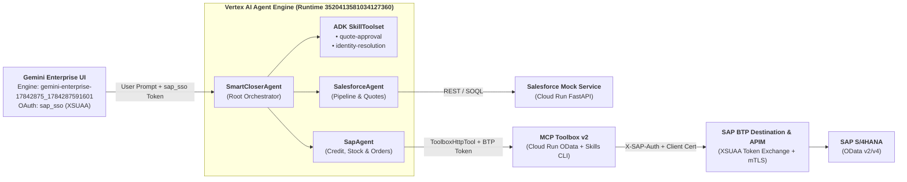

# Smart Closer Agent — Gemini Enterprise ADK Multi-Agent, Skills & MCP Toolbox v2

This repository contains the complete code, ADK skills, multi-agent prompts, backend MCP Toolbox v2, and registration scripts used to build and deploy the **Smart Closer Agent** inside **Gemini Enterprise** (`gemini-enterprise-17842875_1784287591601` $
ightarrow$ `reasoningEngines/3520413581034127360`).

---

## 🏗️ End-to-End Architecture

---

## 🚀 How the Gemini Enterprise App Was Built (4 Layers)

### Layer 1: Backend Services (`mcp-toolbox-v2/` & `salesforce-mock/`)
1. **MCP Toolbox v2 ([`mcp-toolbox-v2/`](./mcp-toolbox-v2))**:
   - Extended Google's `mcp-toolbox` in Go with:
     - **SAP OData Source & Tool Adapter** ([`internal/sources/odata/`](./mcp-toolbox-v2/internal/sources/odata) & [`internal/tools/odata/`](./mcp-toolbox-v2/internal/tools/odata)) supporting SAP Gateway CSRF token handshakes, X.509 client certificates, and `X-SAP-Auth` principal propagation.
     - **Skills Generator CLI** ([`cmd/internal/skills/`](./mcp-toolbox-v2/cmd/internal/skills)) providing `skills-generate` to auto-generate ADK skill packages from [`tools.yaml`](./mcp-toolbox-v2/tools.yaml).
   - Deployed to Cloud Run via [`deploy_isolated_service.sh`](./mcp-toolbox-v2/deploy_isolated_service.sh).
2. **Salesforce Lightning Mock ([`salesforce-mock/`](./salesforce-mock))**:
   - FastAPI service ([`main.py`](./salesforce-mock/main.py)) exposing `/opportunities/open` and Salesforce `/services/data/v58.0/` SOQL, `Quote`, `QuoteLineItem`, and `Opportunity` endpoints.

### Layer 2: ADK Skills & Multi-Agent Runtime ([`app_skills/`](./app_skills))
- **Multi-Agent Orchestration ([`app_skills/agent.py`](./app_skills/agent.py) & [`app_skills/tools.py`](./app_skills/tools.py))**:
  - **`SmartCloserAgent`** ([`prompts/SmartCloserAgent.md`](./app_skills/prompts/SmartCloserAgent.md)): Root orchestrator that coordinates discovery across Salesforce and SAP, enforces manager quote approval guardrails, and renders the Sales Command Dashboard.
  - **`SalesforceAgent`** ([`prompts/SalesforceAgent.md`](./app_skills/prompts/SalesforceAgent.md)): Queries open opportunities, creates Salesforce Quotes & Quote Line Items, and updates Opportunities to `Closed Won`.
  - **`SapAgent`** ([`prompts/SapAgent.md`](./app_skills/prompts/SapAgent.md)): Uses `ToolboxHttpTool` to exchange the user's Gemini Enterprise XSUAA token for an SAP BTP Destination token and invokes batched OData queries (`get_sap_credit_status`, `read_material_stock`, `create_sales_order_header`, `create_sales_order_item`, `read_sales_order_header`, `read_sales_order_item`).
- **ADK Skills ([`app_skills/skills/`](./app_skills/skills))**:
  - **[`quote-approval`](./app_skills/skills/quote-approval/SKILL.md)**: Enforces the in-chat Manager Approval Card before any quote or sales order is created.
  - **[`identity-resolution`](./app_skills/skills/identity-resolution/SKILL.md)**: Executes [`scripts/identity_resolver.py`](./app_skills/skills/identity-resolution/scripts/identity_resolver.py) via `run_skill_script` to batch-translate Salesforce Account IDs and Product Codes into SAP Business Partner (`1000329`–`1000338`) and Material (`TG10`–`TG22`) IDs.

### Layer 3: Deploying to Vertex AI Agent Engine
- Deployed using [`app_skills/deploy_skills_agent.sh`](./app_skills/deploy_skills_agent.sh) (wrapping [`app_skills/utils/deploy.py`](./app_skills/utils/deploy.py)), which packages `app_skills/` into Vertex AI Reasoning Engine `3520413581034127360` (`entrypointModule: app_skills.agent_engine_app`, `entrypointObject: agent_engine`) and binds all Secret Manager secrets (`TOOLBOX_URL`, `SFDC_BASE_URL`, `SAP_BTP_*`, `GEMINI_ENTERPRISE_*`).

### Layer 4: Registering in Gemini Enterprise
- Registered into Gemini Enterprise Engine `gemini-enterprise-17842875_1784287591601` using [`app_skills/register_gemini_enterprise.sh`](./app_skills/register_gemini_enterprise.sh):
  1. Creates the `sap_sso` OAuth 2.0 Authorization (`projects/483251484488/locations/global/authorizations/sap_sso`) pointing to SAP BTP XSUAA (`sb-ms-demos-smartclose!t4152`).
  2. Registers **Smart Closer Agent** (`agents/1452461629541061251`) under `default_assistant`, linking `reasoningEngines/3520413581034127360` with `toolAuthorizations: [".../authorizations/sap_sso"]`.
