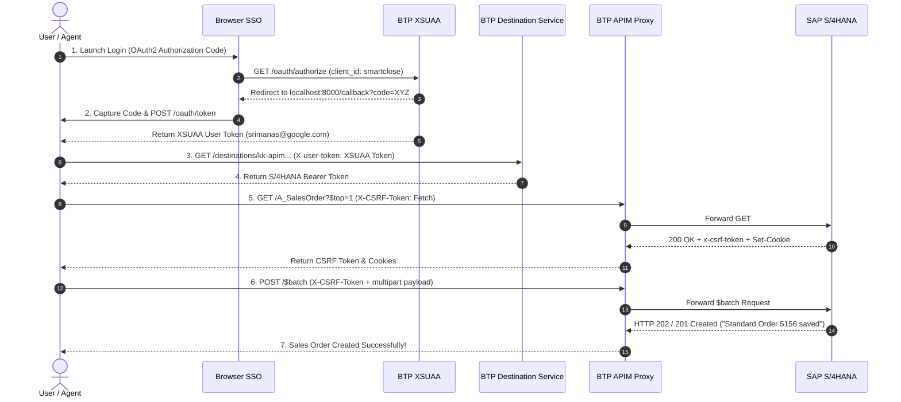

# SAP BTP API Management & S/4HANA Principal Propagation Integration Guide

This document outlines the complete step-by-step configuration required in **SAP BTP Cockpit**, **BTP Destination Service**, **BTP API Management (APIM)**, and **XSUAA** to achieve seamless OAuth 2.0 Principal Propagation and automated Sales Order creation in SAP S/4HANA.

---

## 1. Prerequisites Checklist

Ensure the following components are already provisioned in your SAP BTP Subaccount:
- [x] **SAP S/4HANA System**: Connected to SAP Cloud Connector with principal propagation mapping (`srimanas@google.com` $\rightarrow$ SAP User `SRIMANAS`).
- [x] **SAP Cloud Connector**: Connected to BTP Subaccount with trusted X.509 certificate.
- [x] **XSUAA Service Instance**: Plan `application` (e.g., `sb-ms-demos-smartclose!t4152`).
- [x] **Destination Lite Service Instance**: Plan `lite` (e.g., `destination-xsappname`).
- [x] **SAP Integration Suite / API Management**: API Portal & Developer Portal enabled.

---

## 2. SAP BTP Destination Configuration

Create a HTTP Destination in **SAP BTP Cockpit $\rightarrow$ Connectivity $\rightarrow$ Destinations**.

### Destination Parameters:

| Parameter Name | Value | Description |
| :--- | :--- | :--- |
| **Name** | `ms-smart-close-destination` | Dedicated destination for SmartClose Agent |
| **Type** | `HTTP` | Standard HTTP destination |
| **URL** | `https://sapongcpdemos.apimanagement.us30.hana.ondemand.com` | Base URL of your APIM Proxy or Cloud Connector |
| **ProxyType** | `Internet` | Set to `Internet` if targeting APIM Gateway |
| **Authentication** | `OAuth2UserTokenExchange` | Enables BTP Principal Propagation based on user JWT |
| **tokenServiceURLType** | `Dedicated` | Dedicated XSUAA token service |
| **tokenServiceURL** | `https://<tenant>.authentication.<region>.hana.ondemand.com/oauth/token` | XSUAA Token Endpoint URL |
| **clientId** | `sb-opproxy-xsuaa-clone_...` | XSUAA Service Binding Client ID |
| **clientSecret** | `<xsuaa_client_secret>` | XSUAA Service Binding Client Secret |

> **Key Takeaway**: When configured with `OAuth2UserTokenExchange`, BTP Destination Service takes the user's incoming XSUAA token (`X-user-token` header) and exchanges it for a target Bearer Token representing the authenticated user (`srimanas@google.com`).

---

## 3. SAP BTP API Management (APIM) Configuration

### 3.1 API Proxy Details
- **API Proxy Name**: `MS_DEMOS_API_SALES_ORDER_SRV`
- **APIM Base Path**: `/MS_DEMOS_API_SALES_ORDER_SRV`
- **Target URL**: `https://<cloud_connector_host>:<port>/sap/opu/odata/sap/API_SALES_ORDER_SRV` (or internal Cloud Connector virtual host)

### 3.2 Key Policies Configuration (APIM Policy Editor)

To ensure smooth header propagation and session handling:

#### Policy 1: Header Preservation (AssignMessage)
Ensure incoming `Authorization`, `X-CSRF-Token`, `Content-Type`, and `Cookie` headers are passed intact to the target backend.

```xml
<AssignMessage async="false" continueOnError="false" enabled="true" xmlns="http://www.sap.com/apimgmt">
    <Set>
        <Headers>
            <Header name="Authorization">{request.header.Authorization}</Header>
            <Header name="X-CSRF-Token">{request.header.X-CSRF-Token}</Header>
        </Headers>
    </Set>
    <IgnoreUnresolvedVariables>true</IgnoreUnresolvedVariables>
    <AssignTo createNew="false" type="request"/>
</AssignMessage>
```

> **Important XML Schema Rules in SAP APIM**:
> 1. Always specify `xmlns="http://www.sap.com/apimgmt"`.
> 2. Do **NOT** include `<DisplayName>` elements in XML policies (triggers Xerces schema error).
> 3. Do **NOT** add `name="..."` attribute inside `<AssignMessage>` tag.
> 4. In `<Set>`, elements MUST follow strict sequence: `<Headers>` before `<Verb>`.

---

## 4. End-to-End OAuth 2.0 Execution Flow

The sequence executed by the Python client / MCP Agent follows 5 automated steps:



---

## 5. Complete Python Automation Script

Below is the complete, self-contained Python script implementing the interactive SSO login, BTP Destination Exchange, CSRF handshake, and OData `$batch` creation:

```python
#!/usr/bin/env python3
"""
SAP BTP Interactive SSO & S/4HANA Sales Order Automation Script
"""

import os
import sys
import json
import webbrowser
import urllib.request
import urllib.parse
import http.cookiejar
from http.server import HTTPServer, BaseHTTPRequestHandler

# ---------------------------------------------------------------------------
# SAP BTP Service Credentials
# ---------------------------------------------------------------------------
# Smartclose XSUAA Service Binding (Application User Token)
XSUAA_CLIENT_ID = "sb-ms-demos-smartclose!t4152"
XSUAA_CLIENT_SECRET = "<YOUR_XSUAA_CLIENT_SECRET>"
XSUAA_AUTH_URL = "https://google-connectors-wlgpgm7r.authentication.us30.hana.ondemand.com/oauth/authorize"
XSUAA_TOKEN_URL = "https://google-connectors-wlgpgm7r.authentication.us30.hana.ondemand.com/oauth/token"

# Destination Lite Service Binding
DEST_CLIENT_ID = "sb-clone9e7da8c78c1744c1a6879aea4c0d95a1!b4152|destination-xsappname!b24"
DEST_CLIENT_SECRET = "<REDACTED_SAP_XSUAA_CLIENT_SECRET>"
DEST_TOKEN_URL = "https://google-connectors-wlgpgm7r.authentication.us30.hana.ondemand.com/oauth/token"

DESTINATION_NAME = "kk-apim-user-token-exchange-dest"
DEST_SERVICE_URL = f"https://destination-configuration.cfapps.us30.hana.ondemand.com/destination-configuration/v1/destinations/{DESTINATION_NAME}"

APIM_BASE_URL = "https://sapongcpdemos.apimanagement.us30.hana.ondemand.com:443/MS_DEMOS_API_SALES_ORDER_SRV"
BATCH_URL = f"{APIM_BASE_URL}/$batch"

PORT = 8000
REDIRECT_URI = f"http://localhost:{PORT}/callback"

auth_code_container = {}


class OAuthCallbackHandler(BaseHTTPRequestHandler):
    def do_GET(self):
        parsed = urllib.parse.urlparse(self.path)
        query = urllib.parse.parse_qs(parsed.query)
        if "code" in query:
            auth_code_container["code"] = query["code"][0]
            self.send_response(200)
            self.send_header("Content-Type", "text/html")
            self.end_headers()
            self.wfile.write(b"<html><body><h1>Authentication Successful!</h1><p>Return to terminal.</p></body></html>")
        else:
            self.send_response(400)
            self.end_headers()

    def log_message(self, format, *args):
        return


def get_xsuaa_user_token_interactive():
    print("\n🌐 Step 1: Launching Interactive SAP BTP Browser Login...")
    auth_params = {
        "response_type": "code",
        "client_id": XSUAA_CLIENT_ID,
        "redirect_uri": REDIRECT_URI
    }
    login_url = f"{XSUAA_AUTH_URL}?{urllib.parse.urlencode(auth_params)}"
    webbrowser.open(login_url)
    
    server = HTTPServer(("127.0.0.1", PORT), OAuthCallbackHandler)
    while "code" not in auth_code_container:
        server.handle_request()
    server.server_close()
    
    auth_code = auth_code_container["code"]
    token_params = {
        "grant_type": "authorization_code",
        "code": auth_code,
        "redirect_uri": REDIRECT_URI,
        "client_id": XSUAA_CLIENT_ID,
        "client_secret": XSUAA_CLIENT_SECRET
    }
    data = urllib.parse.urlencode(token_params).encode("utf-8")
    req = urllib.request.Request(
        XSUAA_TOKEN_URL,
        data=data,
        headers={"Content-Type": "application/x-www-form-urlencoded"}
    )
    with urllib.request.urlopen(req) as resp:
        return json.loads(resp.read().decode("utf-8")).get("access_token")


def fetch_oauth_token(url, client_id, client_secret):
    data = urllib.parse.urlencode({
        "grant_type": "client_credentials",
        "client_id": client_id,
        "client_secret": client_secret
    }).encode("utf-8")
    req = urllib.request.Request(url, data=data, headers={"Content-Type": "application/x-www-form-urlencoded"})
    with urllib.request.urlopen(req) as resp:
        return json.loads(resp.read().decode("utf-8")).get("access_token")


def get_s4hana_token(xsuaa_user_token, dest_service_token):
    print("🔄 Step 2: Performing BTP Destination User Token Exchange...")
    req = urllib.request.Request(
        DEST_SERVICE_URL,
        headers={
            "Authorization": f"Bearer {dest_service_token}",
            "X-user-token": xsuaa_user_token
        }
    )
    with urllib.request.urlopen(req) as resp:
        dest_data = json.loads(resp.read().decode("utf-8"))
        auth_tokens = dest_data.get("authTokens", [])
        http_header = auth_tokens[0].get("http_header", {}) if auth_tokens else {}
        val = http_header.get("value") or auth_tokens[0].get("value")
        return val[7:] if val.startswith("Bearer ") else val


def create_sales_order(s4_bearer_token, customer_id="17100003", po_reference="AUTO-SSO-TEST"):
    cookie_jar = http.cookiejar.CookieJar()
    opener = urllib.request.build_opener(urllib.request.HTTPCookieProcessor(cookie_jar))
    bearer_header = f"Bearer {s4_bearer_token}"

    print("🛡️ Step 3: Fetching CSRF Token & Session Cookies from SAP...")
    req_get = urllib.request.Request(
        f"{APIM_BASE_URL}/A_SalesOrder?$top=1",
        headers={"Authorization": bearer_header, "X-CSRF-Token": "Fetch", "X-Requested-With": "XMLHttpRequest"}
    )
    with opener.open(req_get) as resp:
        csrf_token = resp.headers.get("x-csrf-token") or resp.headers.get("X-CSRF-Token")

    print("🚀 Step 4: Sending $batch POST Request to S/4HANA...")
    payload = {
        "SalesOrderType": "OR",
        "SalesOrganization": "1710",
        "DistributionChannel": "10",
        "OrganizationDivision": "00",
        "SoldToParty": customer_id,
        "PurchaseOrderByCustomer": po_reference
    }
    
    batch_body = (
        f"--batch_123\r\n"
        f"Content-Type: multipart/mixed; boundary=changeset_123\r\n\r\n"
        f"--changeset_123\r\n"
        f"Content-Type: application/http\r\n"
        f"Content-Transfer-Encoding: binary\r\n\r\n"
        f"POST A_SalesOrder HTTP/1.1\r\n"
        f"Content-Type: application/json\r\n"
        f"Accept: application/json\r\n\r\n"
        f"{json.dumps(payload)}\r\n\r\n"
        f"--changeset_123--\r\n"
        f"--batch_123--"
    ).encode("utf-8")

    req_post = urllib.request.Request(
        BATCH_URL,
        data=batch_body,
        headers={
            "Authorization": bearer_header,
            "X-CSRF-Token": csrf_token,
            "X-Requested-With": "XMLHttpRequest",
            "Content-Type": "multipart/mixed; boundary=batch_123",
            "Accept": "application/json"
        },
        method="POST"
    )
    
    with opener.open(req_post) as resp:
        res_body = resp.read().decode("utf-8")
        print("\n🎉 SUCCESS! Sales Order created in SAP S/4HANA!\n")
        print(res_body)
        return res_body


if __name__ == "__main__":
    user_token = get_xsuaa_user_token_interactive()
    dest_token = fetch_oauth_token(DEST_TOKEN_URL, DEST_CLIENT_ID, DEST_CLIENT_SECRET)
    s4_token = get_s4hana_token(user_token, dest_token)
    create_sales_order(s4_token)
```
